<div align="center">


# Mattiverse

**Install, update and back up your Docker apps. One launcher for the whole Mat universe.**

A home screen for your Docker host: pick an app in the store, Mattiverse installs it, gives it a
domain, keeps it up to date and backs it up. It is the friendly layer on top of three programs that do the real work and
keep their own part of the configuration: [MatDock](https://github.com/Real-TTX/MatDock) (stacks, backups),
[Matcad](https://github.com/Real-TTX/Matcad) (addresses, HTTPS) and [Matddns](https://github.com/Real-TTX/Matddns) (DNS records).
Open one of them and you see what Mattiverse set up there.

</div>

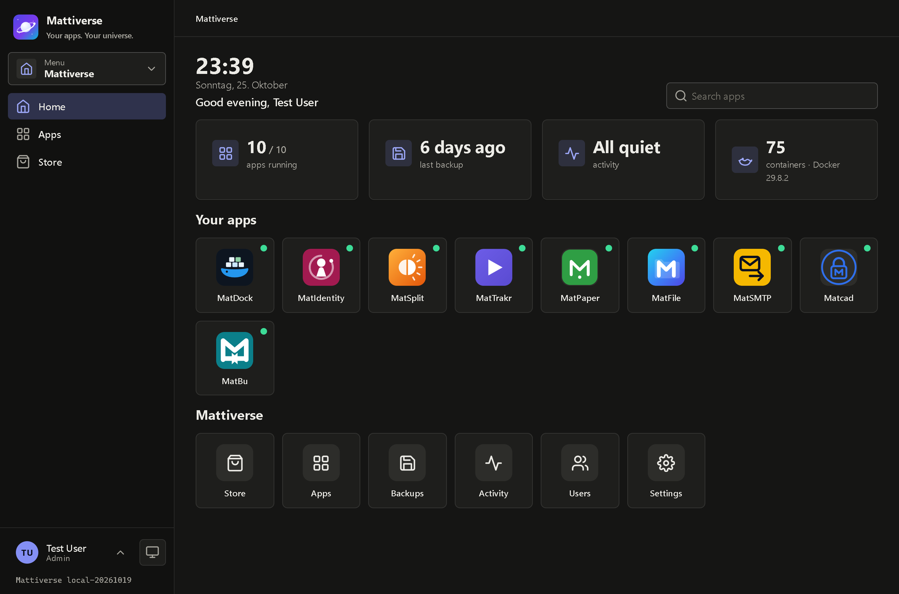

---

## What this is about

Self-hosting usually means a terminal, a pile of `docker-compose.yml` files and a browser full of
`:8080` tabs. Mattiverse is a calm layer on top: a launcher that looks like a phone, a **store** with
one-click installs, a **setup wizard** that asks for your domain and DNS account once and wires the engines together,
and **backups** you can actually restore.

It is the small, mobile-friendly sibling to **MatOS**. Where MatOS is a desktop with windows, Mattiverse
shows one app at a time, like a website or a phone. Every app is a plain `docker compose` stack in MatDock: you can edit
it there, and Mattiverse keeps your change when it updates the app.

## At a glance

**Launcher**
- Installed apps as **icons on a home screen** with a status dot, a search field and widgets (apps running, last
  backup, activity, Docker)
- **One app open at a time**: the app fills the screen with a bar to go back (apps that forbid being embedded
  open in a new tab)
- Account, theme (**System / Light / Dark**) and sign-out at the **bottom left** of the menu; on a phone the menu
  is a drawer

**Setup wizard** (first start, and again whenever you like)
- Installs the three **engines**: MatDock (required), Matcad and Matddns (skip one if something else on the host does its job)
- Your **domain** and your **DNS provider** (Cloudflare, Hetzner, Netcup), asked once: Matcad gets one wildcard certificate through the
  DNS challenge and a route `app.example.com` per app, Matddns keeps the DNS records on your home IP
- Everything the wizard created carries a **Managed by Mattiverse** badge in the engine

**Store**
- Catalog of your Mat apps (MatMail, MatFile, MatPaper, MatPlay, MatSplit, Matmon, MatCMS, Matdo, MatBu,
  MatTrakr), [MatDesign](https://github.com/Real-TTX/MatDesign) (the design and identity of all of them) and the infrastructure apps
- **Passwords are generated** and shown (hidden until you ask) on the app's page
- Add your **own apps** by dropping a compose file into `/data/catalog` (see [docs/CATALOG.md](docs/CATALOG.md))

**Operations**
- **Install, update, start, stop, restart, uninstall**: every long task is a job with a **live log**
- **Update** pulls newer images, re-creates only what changed, and backs up first if you want
- **Backups** are MatDock's: compose + `.env` + all volumes, optionally with the app stopped (consistent databases),
  **schedules with retention**, restore even after the app was uninstalled, download as `.tar`. They show up in MatDock too
- If you **change a stack in MatDock**, the next update keeps your version
- **Shared links** let someone without an account open one app

**Users**
- Local sign-in, **roles Admin / User / Anonymous (shared link)**, sessions that **survive a restart**
  (Microsoft Entra ID is prepared, see [Status](#status))

## Screenshots

### The store and the setup wizard

| Store | Wizard: the engines | Wizard: domain and DNS |
|---|---|---|
| 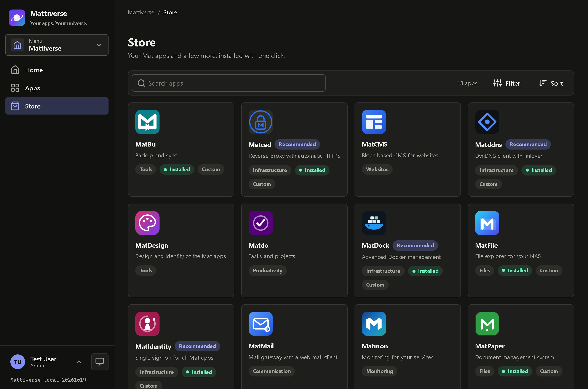 | 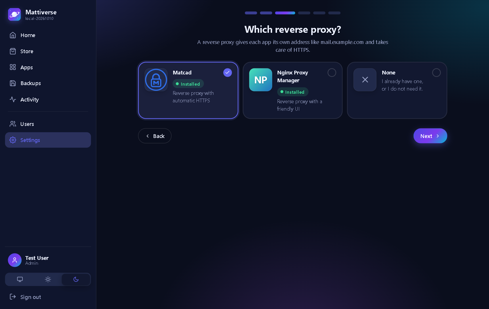 | 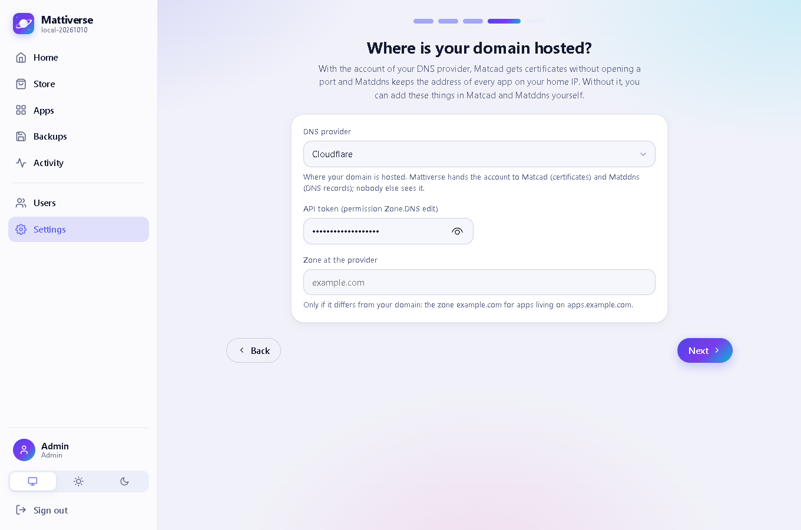 |

The wizard warns when a port it needs is taken (for example when another proxy holds 80 and 443) and leaves
alone what is installed already. The DNS account is asked once and handed to Matcad and Matddns.

### The engines

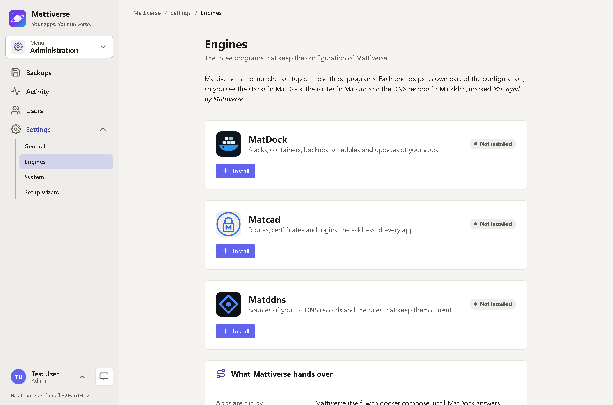

The *Engines* tab shows which engine answers, opens it, and hands the domain and the DNS account over again (*Connect again*).
Each app page links to where its stack, route and DNS record live in the engines.

### Apps, installs with a live log

| An app | The install log |
|---|---|
| 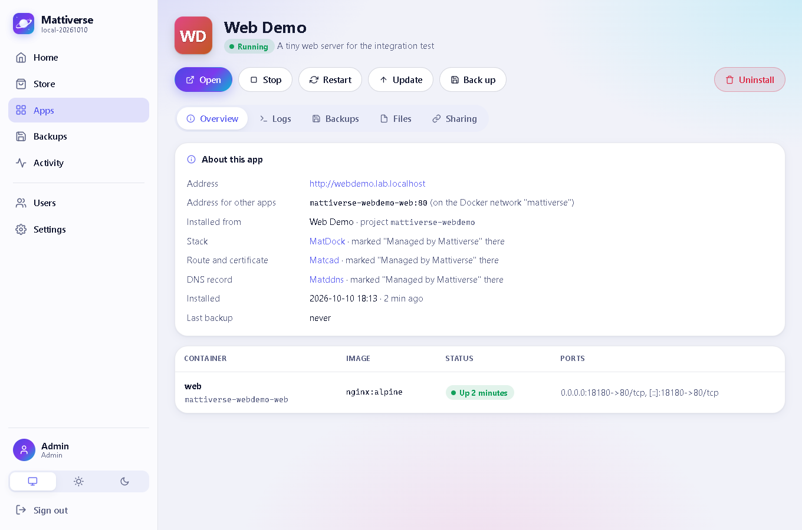 | 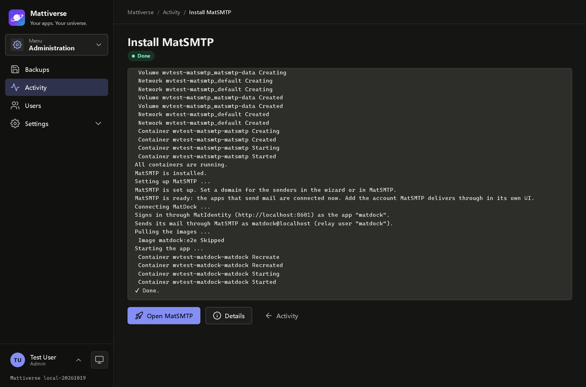 |

Buttons read from positive to negative: **Open, Stop, Restart, Update, Back up**, then a gap, then **Uninstall**.

### Backups

| History | Schedules |
|---|---|
| 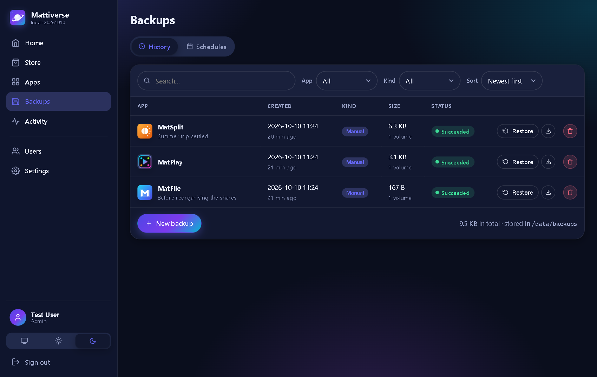 | 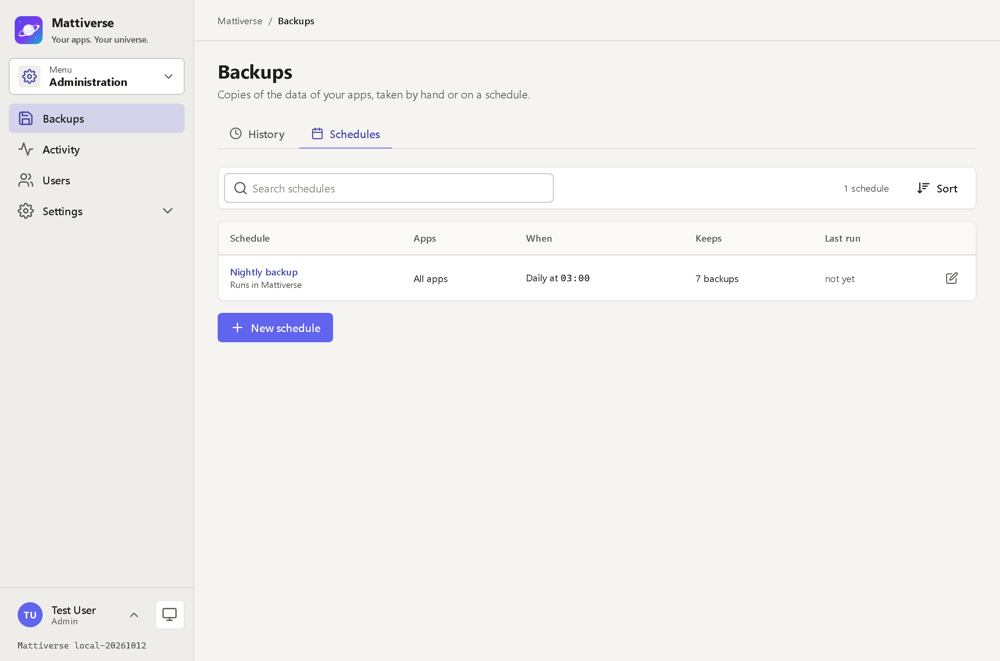 |

One list for all backups: those MatDock made (badge *MatDock*, also visible in MatDock) next to those of Mattiverse's own runner.
Every list has its toolbar (search, filters, sort) on top, its actions below and pagination directly under the table.

### Light theme and phone

| Light | Phone | Phone menu |
|---|---|---|
| 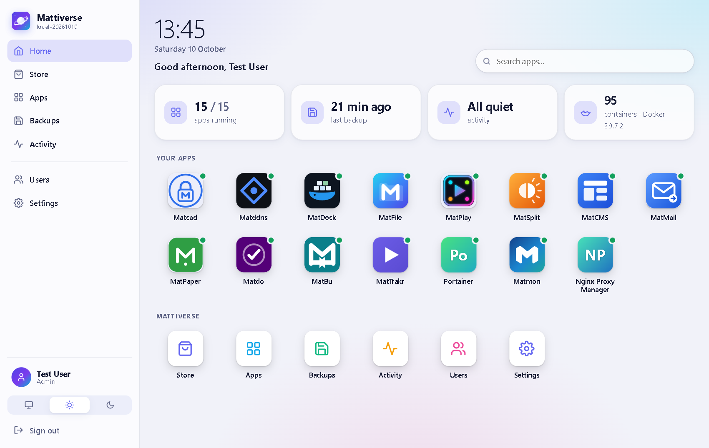 | 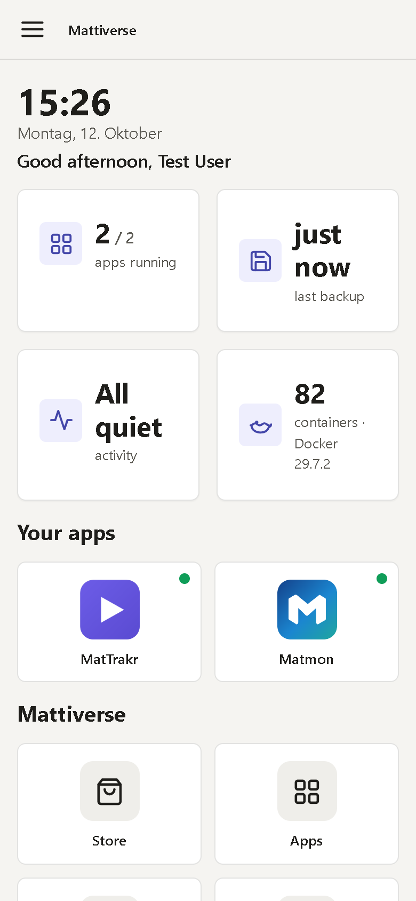 | 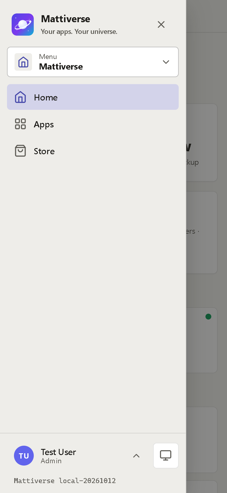 |

## Quick start

One command. The Docker socket is how Mattiverse installs and manages your apps.

```bash
docker run -d --name mattiverse --restart unless-stopped -p 8030:8030 \
  -v mattiverse-data:/data \
  -v /var/run/docker.sock:/var/run/docker.sock \
  ghcr.io/real-ttx/mattiverse:latest
```

or with Compose:

```yaml
name: mattiverse

services:
  mattiverse:
    image: ghcr.io/real-ttx/mattiverse:latest
    container_name: mattiverse
    restart: unless-stopped
    ports:
      - "8030:8030"
    volumes:
      - mattiverse-data:/data
      - /var/run/docker.sock:/var/run/docker.sock

volumes:
  mattiverse-data:
```

Open **http://localhost:8030**. The first start asks for the administrator account and then walks you through the
setup wizard. An update is `docker compose pull && docker compose up -d`; everything lives in the `mattiverse-data` volume.

| Tag | Built from | Use it for |
|---|---|---|
| `ghcr.io/real-ttx/mattiverse:latest` | `main` | releases |
| `ghcr.io/real-ttx/mattiverse:nightly` | `dev` | the newest features |

> **The Docker socket is root on the host.** Mattiverse needs it, so keep the UI off the public internet:
> put it behind your reverse proxy with the apps' own logins, or on a VPN.

### Settings that matter

| Variable | Default | Meaning |
|---|---|---|
| `Mattiverse__DataPath` | `/data` | Data folder: database, settings, compose files, backups |
| `Mattiverse__SessionLifetimeDays` | `30` | How long a sign-in stays valid |
| `Mattiverse__NetworkName` | `mattiverse` | Shared Docker network of the engines and the apps' UIs |
| `Mattiverse__NetworkSubnet` | – | Subnet (like `10.253.200.0/24`) for that network, if Docker's default address pools are used up |
| `Mattiverse__HostPortRangeStart` / `End` | `8100` / `8999` | Pool for app ports when the preferred port is taken |
| `Mattiverse__Admin__Seed` | `false` | Create the admin from `__Username` / `__Password` (headless installs; the password must be changed at the first sign-in) |
| `Mattiverse__DockerHost` | – | Use another Docker endpoint than the mounted socket |
| `MATTIVERSE_PORT` | `8030` | Host port in the compose files |
| `TZ` | – | Time zone for schedules and the apps |

## How it works

```
/data
├─ mattiverse.db        SQLite: users, sessions, apps, jobs, shared links (and the backups of apps Mattiverse runs itself)
├─ config/system.json   JSON: name, domain, DNS provider, the wizard's choices
├─ dataprotection-keys/ keys for the cookies and the secrets (so sessions survive restarts)
├─ catalog/             your own app definitions (*.yml)
└─ apps/<app>/          only for stacks Mattiverse runs itself (MatDock, and apps while MatDock is not up): docker-compose.yml, .env
```

- An app is a **compose project** named `mattiverse-<app>`. Mattiverse renders the catalog entry into one compose file (container
  names, labels, the shared network, the host port of the UI, an `x-matdock` block) plus a `.env` with your answers and creates it as a
  **stack in MatDock** through MatDock's REST API. The stack is yours to edit there; an update keeps your version.
- Status, containers and logs are read straight from Docker, so the launcher stays correct when an engine is down.
- Containers of an app are only attached to the **shared network** `mattiverse` when they must be reachable by
  the proxy (the UI service); databases stay private to their stack.
- With a domain, every install creates the route `<app>.<domain>` in **Matcad** and the record in **Matddns**; uninstalling removes both.
  Mattiverse itself gets a route too. With a DNS account Matcad issues one wildcard certificate through the DNS challenge.
- **Backups** are made by MatDock (a bundle of volumes, compose and `.env`) and listed in MatDock too; the apps that Mattiverse runs itself
  are backed up by Mattiverse's own runner. One page shows both.
- Without an engine's API (an older image, or not installed yet) Mattiverse falls back to its own `docker compose` runner, so nothing stops working.
- The design decisions (what the engines own, where the compose files are, how this relates to MatOS) are in
  [docs/ARCHITECTURE.md](docs/ARCHITECTURE.md); the contract with the engines is [docs/ENGINES.md](docs/ENGINES.md).

## Roles

| Role | Can |
|---|---|
| **Admin** | everything: store, installs, updates, backups, users, settings, activity |
| **User** | see and open the apps (no credentials, no actions) |
| **Anonymous** | open the one app behind a **shared link** (`/s/<token>`); links expire and can be revoked |

## Development

Stack: ASP.NET Core 10 (Razor Pages), C#, SQLite via EF Core, the `docker` CLI against the mounted socket, plain
JavaScript. No Node build step.

```bash
dotnet build Mattiverse.slnx          # 0 warnings expected
dotnet test                           # unit tests (catalog, installer files, backups, schedules, parsing)
./scripts/redeploy.ps1                # rebuild the container and redeploy the dev stack
./scripts/redeploy.ps1 -Fresh         # ... with a clean data volume (the first-run setup appears again)
```

The dev stack is the app plus a SQLite web viewer (the SQLite counterpart of pgAdmin) on
`http://localhost:8021`. In `Development` a ready-made account **`tester` / `Tester123!`** exists, so testing never
touches the real administrator. `MATTIVERSE_PORT` changes the host port when 8030 is taken.

Testing means rebuilding the container and redeploying the stack, nothing else.

### Branches and versions

| Branch | Purpose | Image tag | Version |
|---|---|---|---|
| `main` | Release | `latest`, `release`, `<version>` | `<major>.<minor>.<build>-<yyyyMMdd>` |
| `dev` | Development | `nightly`, `<version>` | `nightly-<build>-<yyyyMMdd>` |
| local | – | – | `local-<yyyyMMdd>` |

`major` and `minor` live in [`Directory.Build.props`](Directory.Build.props); the build number is the run number of the
GitHub Action, which also builds the multi-arch image (`amd64`, `arm64`).

## Status

| Area | Status |
|---|---|
| Launcher, store, wizard, themes, mobile layout | ✅ |
| Install / update / uninstall / start / stop with live logs | ✅ |
| Backups: manual, scheduled, retention, restore, download (MatDock's, merged with Mattiverse's own) | ✅ |
| Local users, roles, persistent sessions, shared links | ✅ |
| Apps as MatDock stacks, routes in Matcad, DNS records in Matddns, domain and DNS account asked once | ✅ |
| Stack edited in MatDock survives an update | ✅ |
| Microsoft Entra ID sign-in | planned (the login is already behind `AuthService` / `SessionService`) |
| Remote backup targets (SMB, off-site) | MatDock's backup targets |
| The engine APIs | on the `mattiverse-integration` branches of MatDock, Matcad and Matddns; they reach the released images with the next release of each ([docs/INTEGRATION.md](docs/INTEGRATION.md)) |

## License

No license file is included yet. If you intend others to reuse this, add a `LICENSE` (for example MIT) at the repo root.
